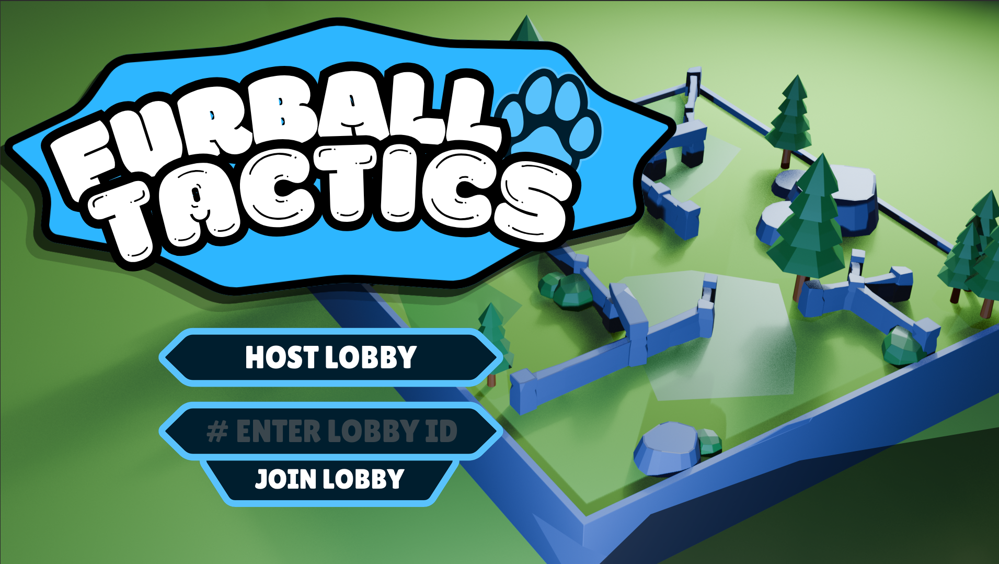

# 🌟 Implications

__🏁 Finished Digital Outcome__  

## 1️⃣ Privacy

__Is Data Kept Private?__

Through my application it does not in any regard record the information of the user that uses my program. I have not implemented the use of tracking or copying the tasks that the user has made when using the application via a txt file for example, to write the information according to the tasks made. My program is although connected to a multiplayer network is entirely anonymous, therefore there is no endangerment of exposed IP Adresses. I furthermore ensure that there is no mandatory collection of private data such as real names, date of birth or any private information.

## 2️⃣ Aesthetics

__Does it Look Good?__  
__How does your choice in design influence human emotion?__

### Design Elements - Individual Features

__Line__  
I have used a multitude of division lines such as frame widgets to separate the two differently functioning widgets. These rigid lines create a sense of organisation, mild complexity and minimalism. The lines cause the viewer's eyes to become limited in the borders/confines that the lines create, ensuring that the user knows what is relative to each other such as the input and the outputs. The lines and borders of the widgets display this functionality aesthetic.
Lines have been used to separate the different elements

__Colour__  
Throughout my entire programme there are a multitude of different colours that have been used to allow the user to focus, differentiate and feel regarding my final digital outcome. 

One example of colour diversity is through the use of my decision to pick the colour blue regarding the: title, button UI and Interface UI. I have decided to use this because in terms of emotion it can be regarded calm, and optimisim. This aids the intention of my game since I intend to influence the player into a competitive spirit accompanied with the idealogy of having competitive fun with friends. Therefore through the use of this colour I have influenced players to percieve my game as a fun experience alongside a competitive theme accompanied with its gameplay.

__Texture__  
I have used a sleek smooth plastic imitating design for the background. The programme uses a soft pastel background for each arena. This design choice was made because of visual clarity. My intention through designing many aspects of my game was to decrease the unecessary amount of resources required to make it less overwhelming for the player's eyes. This means that I wanted players to focus on the gameplay more than having to decipher what enemies are and what they needed to focus on rather than a pool of spaghetti based textures that would provide too much noise to see.

### Design Principles - How Design Elements Work Together

__Alignment__  
I have incorporated alignment in my programme through the use of separating the interactive widgets and the output display of the tasks in the task manager. This gives a more legible and reliable feel to the programme as it allows the user to easily navigate throughout the task manager interface to know where they can modify the widget properties or to make one entirely and furthermore manage it later on.
Widget Alignment using frame Nodes

__Contrast__  
For my final digital outcome I have used High Contrast. This is because I wanted to uphold a jubiliant theme and connotation for a fun experience rather than a horror game with dark and moody aesthetics which would be innappropriate for the game's overall intention. Therefore I did not want players to feel scared when playing my game but thrilled around the possible strategies that can be used against their opponents to gain the competitive edge over their friends.

__Rhythm / Repetition__  
In regards to rythym / repetion I have kept the Widgets Consistent. Alongside the saturated theme of a bright and jubliant theme for players to have a fun experience to not feel overwhelmed by the competitive strategy. This consitency also ensured that players were not lost therefore builds familiarity, reduces cognitive load, and keeps players immersed.

## 3️⃣ End User Considerations

__What Specific Needs does your end user have?__

My program fulfills the initial main purpose that I had stated at the beginning of my intent for the project. My aim for this project was to make a game that players could use their strategic expertise to advance upon one another through the use of different modifiers to enhance their ability and chances of success.

In order to meet these specific needs I have implemented the use of title pages, arenas, player models, weapons, player modifiers and other assortment of resources that provided necessary to meet the expectations of my end users.

__Labels__  
Title - Prompt the user for a task label/description

__Buttons__  
Host Lobby - _Creates a new lobby under the tube client plugin_
Join Lobby - _Joins a lobby given off the line Edit "Lobby ID Session"_
Start Game - _Begins the game when atleast 2 players are loaded in the lobby_
Leave Lobby - _Players will leave the lobby_

__Line Edit__  
Lobby ID Session - _Insert for a string of numbers that the host of the lobby possess to join the hosted server_

## 4️⃣ Usability

__Is it easy to use?__

I have ensured that my program makes it easy for new users to understand the basic functionality of my program with little to no problems to arise. I have ensured that the names on the buttons like "Host Lobby" fulfills the purpose of letting the user know that it is meant to create a new lobby for the current player. I have also ensured that most labels are easy to understand regarding common sense and therefore players should be able to know how to play my game considering my selected audience.