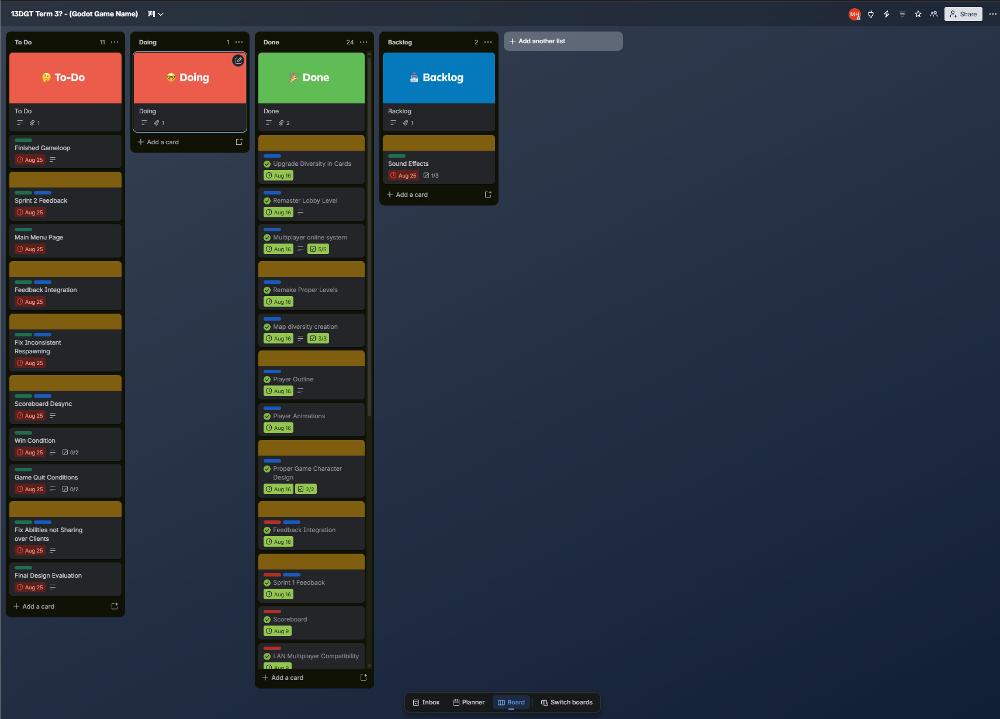
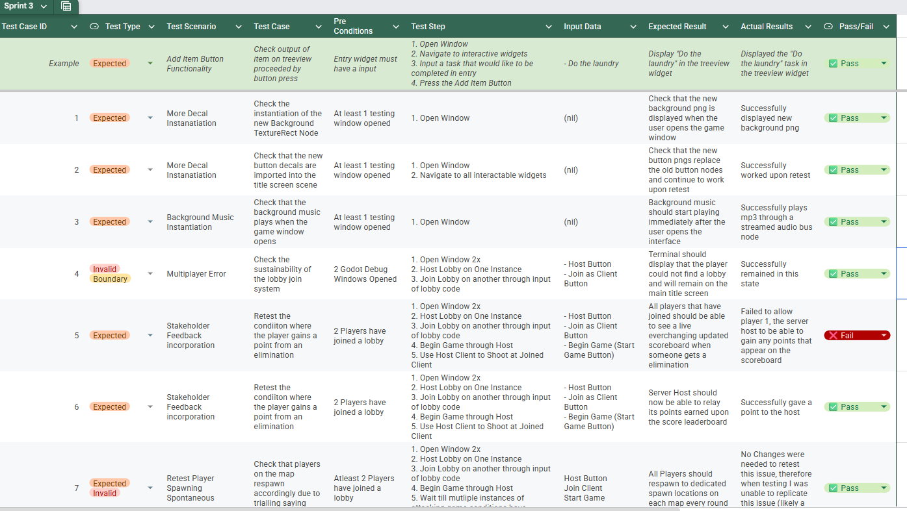
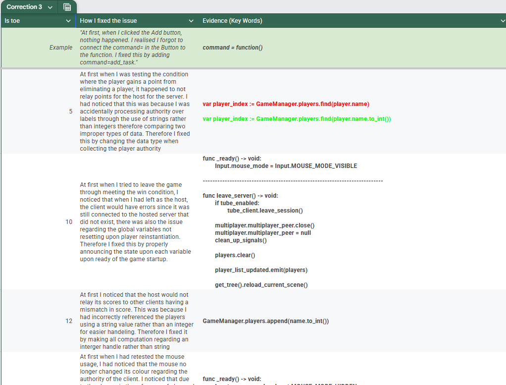

# 🪞 Reflection

__🏁 Finished Digital Outcome__  

## 🗺️ Planning

### Trello Kanban Board

Throughout my program I had used a Kanban Board called Trello. This handy tool allowed me to organise and manage the things that I needed to get done for this project in a more visual manner. This had provided a variety of functions that I had used to my advantage:

* __Individual Columns__ - Separates tasks based on their status
* __Task Tab__ - Tabs to showcase what is needed to be done  
* __Due Date__ - When the task must be started and finished  
* __Description__ - Messages to help understand the task  
* __Checklist__ - Steps in order to complete the certain task

These features furthermore allowed me to stay organised and know exactly what was required to complete this project at certain times when I was available from other work from other classes. Without this tool I would have been less organised and possibly miss features due to obstacles of time and known ability. By planning everything out I was able to visualise what I could and couldn’t do according to my own ability.

### Drawio files

In my planning stages I needed a way to visualise what my project would look like. I used this inbuilt plugin from visual studio called __.drawio__ to visualise the design of my drafts and final iteration for my project. This had features such as already made templates according to the modern OS of most computers for different applications. Without this plugin, it would have been very difficult to understand and comprehend what my project was going to look like and reference for what my code needed to be in order to represent my final desired project.

## 🧪 Testing

When it came to testing my program many, many times for different bugs that could affect the user experience, I used google spreadsheets to help manage these tests. I had recorded a multitude of test cases via the use of this spreadsheet to show how how I tested a certain input and if I received any errors for me to then fix them.

* __Sprint__
  * __Test Case ID__ - Number Identification for each test case
  * __Test Type__
    * __Expected__ - Test case will perform as expected
    * __Boundary__ - Test case will have a certain limit to perform valid
    * __Invalid__ - Test case will have an expected error
  * __Test Scenario__ - Categorisation relative to each test case
  * __Test Case__ - What I am testing in particular
  * __Preconditions__ - What needs to be done before test
  * __Test Steps__ - How I will conduct the test
  * __Input Data__ - What I will enter into the test
  * __Expected Result__ - What I think the output should be
  * __Actual Result__ - What the output turned out to be
  * __Pass / Fail__ - If the output met the expected result
* __Correction__
  * __Test Case ID__ - Number Identification for corresponding test case
  * __How I fixed the issue__ - The problem and process to fix the problem
  * __Evidence (Key Words)__ - The key code that was altered or added to fix the problem

## 👤 Trialling

In order to perform my trialling, I had gathered five stakeholders to give me feedback. The feedback would be collected via google forms in order to ask my stakeholders questions and test the program at its current iteration. I would analyse this feedback and choose the feedback that I deemed fit and appropriate for my program to meet the expectations and qualifications for my end-users.

I had given the image of my current iteration of my program followed by some feedback and rating questions. This ultimately gave me the criticism I needed to progress in my program for my end-user's needs. This will furthermore make my program well-suited for the end-users.

## How each aspect shaped one another

In summary each aspect of revolutionary stakeholder feedback, test cases and inital planning proved pivotal and interchanging to provide a completed final outcome. Drawio files influenced by stakeholders had shaped what the programme looks like today. 

One game aspect of the player identification can be seen evolving throughout my progression of my final digital outcome. Initially in my Kanban Board and Flowchart planning phase I had only throught of differing characters with different colours for their textures using mesh instances which only dictated colour through their looks. However when the players were behind objects it was hard for the end user to find their character with multiple moving objects on screen. Therefore the use of this trialling from stakeholders and the progressive testing recorded in my test cases, I was able to progressively learn a strategy through trial and error a method that would deem apropriate to ensure that this spark of trialling would ensure for easier end user replayability.

Another example is through my multiplayer system. Since through multiple test cases and researching, I had noticed that I had to continue testing different ideas of multiplayer plugins that would work in accordance with my game interface. Therfore my testing process influenced my subsequent planning as I now had to prioritise developing the multiplayer system and that my initial idea of how easy my multiplayer system development would be ultimately changed therefore changed how I would prioritise different elements of my final digital outcome.

 Therefore in conclusion, I believe that I have synthesised through the exemplification of my evolutionary programme that through the use of all these tools, the final outcome has truely become what I expected from it and maybe even beyond for end users to appreciate.