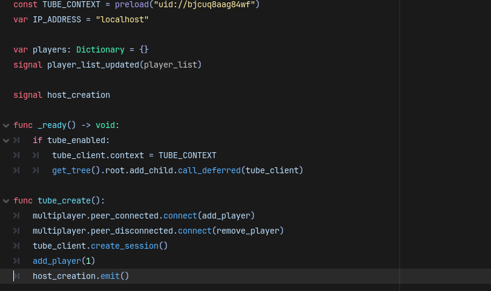
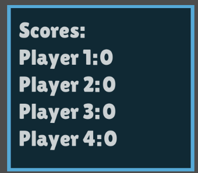
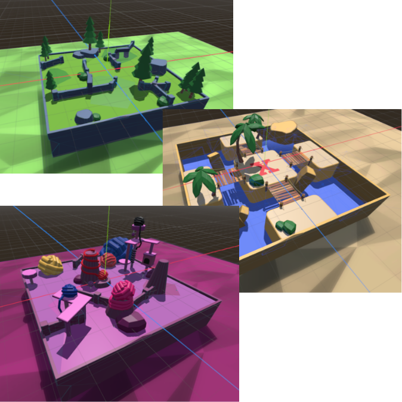

# 📝 Trial Notes

## 🔗 Sprint One → Sprint Two

__Sprint One Design__  

__Sprint Two Design__  

Over the course of my trialling with my stakeholders for my sprint one design, I have gotten mostly constructive criticism which allowed me to make slight improvements from the initial prototype design. This information is gathered via a forum prompting questions for my stakeholders. This will therefore give me the feedback I need to improve my design to fit the needs of my audience.

### 1️⃣ Stakeholder One (Opeloge)

* __Request(s)__

Once I had published my first sprint of my prototype game project, I had recieved a comment from stakeholder one regarding the "Laggy Game" issues of enetmultiplayer. Over the course of their experience they mentioned the issue of an instable connection through the use of VPN's under the school wifi. In order to mitigate this issue I had decided to incorporate a network peer to peer system, as I initially planned. Through New Experimental Network System Through Peer to Peer over local multiplayer + VPN Usage over School Network.

Another comment that was made by stakeholder one was the regards to adding a jumping feature. Upon hearing this I did not decide to add this feature based on regards from my own personally testing. What I mean by this is by adding a jump feature to my game I would be increasing the complexity of the game where players would have to worry about another dimension of playable field. Therefore I decided to neglect this comment since I believed that by not incoporating a jump feature, it would enable players to heavily focus on their horizontal movement and how modifiers could help with enhancing their ability to fend off against their opponents.

* __Integration__

> In order to fix the current local multiplayer that I had made for my Game Project at the time, I had to find another substitute that would meet the requirements of a working peer to peer hosting and joining plugin that would work over different networks. Therefore I applied the request of my first stakeholder by incorporating a new plugin adding a TUBE_CONTEXT reference that would prove necessary to create a temporary server for other clients to join replacing the enetmultiplayer system that Godot provides by default.

### 2️⃣ Stakeholder Two (Astyn)

* __Request(s)__

In regards to my second stakeholder, they had requested that I improve upon the functionality of the scoreboard. This was because during their trailling, they had noticed that the score would not change and was completely ornamental for the gameplay. Therefore for the third sprint of my development phase, I finally decided to implement this feature since this feature would allow players to acknoledge the current competition and come up with new strategies to defeat their opponent.

* __Integration__

> As shown above in the image, this is the final product of the scores display, where players that manage to eliminate another player gain one point. This score system uses RPC annotations to execute this function on all connected clients and syncs up the relative data to properly display the correct scores on all connected clients. This therefore allows other players to think in a strategic manor and influence a more careful mindset for the players.

### 3️⃣ Stakeholder Three (Zane)

* __Request(s)__

In regards to my third stakeholder, they had requested in terms of features and diversity of my current digital outcome, that I incorporate more more Maps/arenas to therefore engage the players with variable play. Ultimately I have decided to incorporate this feature since it aligns with my purpose of my game focusing on the aspect of making an engaging, strategic party game for people to play with their friends.

Another request that my third stakeholder has made is that I implement player indentification. I had pressumed that through their trialling that they noticed it was hard to focus on where their player was amongst the chaotic gameplay. I decided to also implement this feature regarding the quality of life features for player gameplay. Therefore I had ensured that the players had an outline and xray shader through the built in material override that could be duplicated over the current character model that was made in blender.

* __Integration__

> This image demonstrates how I have decided to follow up the request of my third stakeholder. Since my previous prototype only had 3 maps that looked quite similar, I decided to completely overhaul their design for a more professional and complete design. This fufills the request of my stakeholder by adding more variance to my maps making them more unique to give that feel of map variety and prevent repitiveness preventing engaging behaviour.

> Also as demonstrated above I have applied a separate model applied with a shader that allows players to easily see their players behind other objects alongside different colours of character variation to ensure that players are not the same default model and prevent confusing on which player is controlling which model.

## ⛓️ Sprint Two → Sprint Three

__Sprint Two Design__  

__Sprint Three Design__  

Over the course of my trialling with my stakeholders for my sprint two design, I have received some constructive criticism which allowed me to make improvements for the previous second prototype design. This information is gathered via a forum which will therefore give me the feedback I need to improve my design to fit the needs of my audience.

### 1️⃣ Stakeholder One (Opeloge)

* __Request(s)__

Upgrades did not have a significant affect - fixed by making the modifiers much more impactful

Players spawn after only 2 rounds bug - Fixed through testing only to find out minima changes were needed

* __Integration__

>Text

### 2️⃣ Stakeholder Two (Astyn)

* __Request(s)__

Working modifiers - Incorporated ability sync across clients

* __Integration__

>Text

### 3️⃣ Stakeholder Three (Zane)

* __Request(s)__

Unable to provide any feedback in the given time frame therefore an unreliable stakeholder
