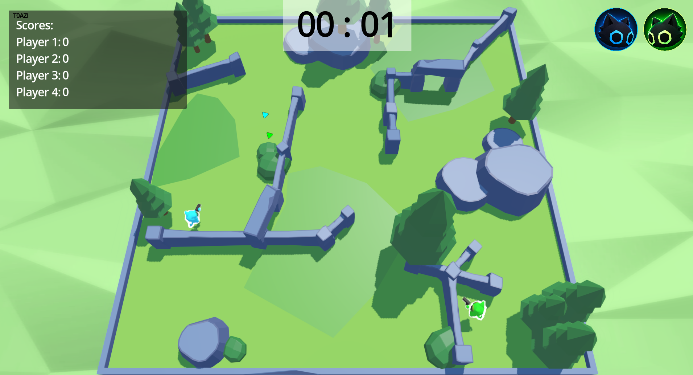
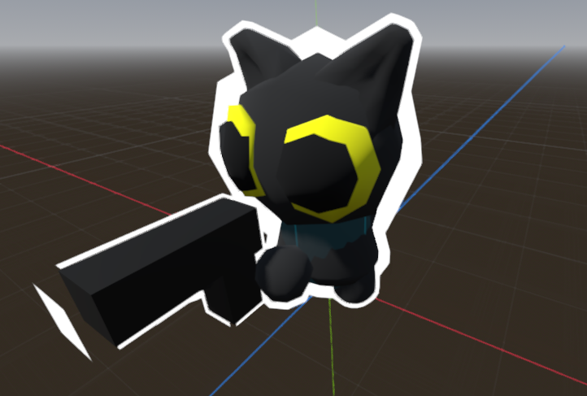
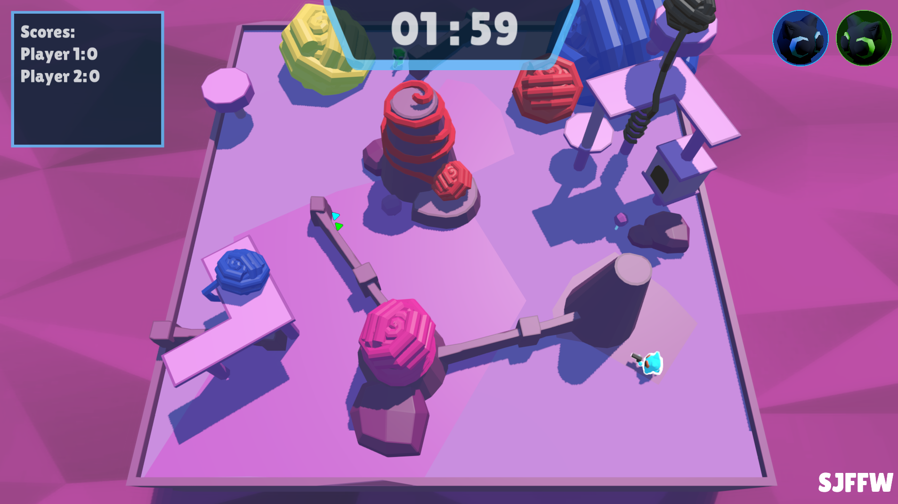

# 📝 Trial Notes

## 🔗 Sprint One → Sprint Two

__Sprint One Design__  

__Sprint Two Design__  

Over the course of my trialling with my stakeholders for my sprint one design, I have gotten mostly constructive criticism which allowed me to make slight improvements from the initial prototype design. This information is gathered via a forum prompting questions for my stakeholders. This will therefore give me the feedback I need to improve my design to fit the needs of my audience.

### 1️⃣ Stakeholder One (Opeloge)

* __Request(s)__

Laggy Game Solved Through New Experimental Network System Through Peer to Peer over local multiplayer + VPN Usage over School Network

Jumping - I did not add due to the complication of a simple strategic game

* __Integration__

>Text

### 2️⃣ Stakeholder Two (Astyn)

* __Request(s)__

Scoreboard Functionality - Integrated in Sprint 3

* __Integration__

>Text

### 3️⃣ Stakeholder Three (Zane)

* __Request(s)__

More Maps

Player Indentifier

* __Integration__

>Text

>Text

## ⛓️ Sprint Two → Sprint Three

__Sprint Two Design__  

__Sprint Three Design__  

Over the course of my trialling with my stakeholders for my sprint two design, I have received some constructive criticism which allowed me to make improvements for the previous second prototype design. This information is gathered via a forum which will therefore give me the feedback I need to improve my design to fit the needs of my audience.

### 1️⃣ Stakeholder One (Opeloge)

* __Request(s)__

Text

* __Integration__

>Text

### 2️⃣ Stakeholder Two (Astyn)

* __Request(s)__

Text

* __Integration__

>Text

### 3️⃣ Stakeholder Three (Zane)

* __Request(s)__

Text

* __Integration__

>Text
